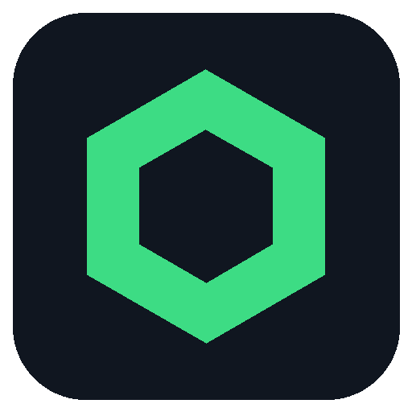

  

<h1 align="center">Hydarium</h1>

<b>The simple, beautiful, community-driven Minecraft launcher.</b> 
Mods, servers, friends and an in-game client: everything in one place, in a few clicks.

  <b>English</b> · <a href="README.md">Français</a>

  
  
  
  
  

  <a href="https://github.com/Gazein21/hydarium/releases/latest"><b>⬇️ Download Hydarium</b></a> ·
  <a href="#-all-features">Features</a> ·
  <a href="#-faq">FAQ</a> ·
  <a href="https://github.com/Gazein21/hydarium/issues">Report a problem</a> ·
  <a href="mailto:help.point@hydarium.net">Contact</a>

---

## ✨ Why Hydarium?

Playing Minecraft with mods, meeting up with friends and hosting a server often means juggling several tools, digging through folders by hand and cryptic settings.

**Hydarium puts everything in a single app**, clear and pleasant to use, where each task takes just a few clicks:

| | |
|---|---|
| 🎮 **Play** | Vanilla, Fabric, Quilt, Forge and NeoForge instances, Microsoft sign-in, Java included. |
| 🧩 **Mod** | Modrinth / CurseForge search, automatic dependencies, integrity checks. |
| 🖥️ **Host** | Your own server in one click; friends join **without any port forwarding**. |
| 👥 **Play together** | Friends, chat, file sharing and voice calls, direct, with no central server. |
| 🎯 **Stand out in game** | A Hydarium client with widgets (FPS, CPS, keystrokes…), zoom and brightness. |
| 🔒 **Respect your privacy** | No data collected or sold. Ever. |

> Hydarium is a personal project: no company behind it, no ads, no account to create with us.

---

## 🚀 Get started in 3 steps

1. **Download** Hydarium from the [releases page](https://github.com/Gazein21/hydarium/releases/latest):
   - **Windows**: `Hydarium-Installer.exe` (or the portable version).
   - **Linux**: `Hydarium-Linux.AppImage`. Make it executable (`chmod +x Hydarium-Linux.AppImage`) and run it, no installation needed.
2. **Launch Hydarium** and sign in with your Microsoft account. Nothing else to install: Java is bundled.
3. **Create an instance** (or drag and drop a modpack into the window) and click **Play**.

Updates then happen **automatically** in the background.

---

## 📖 All features

### 🎮 Play and organize your instances

An *instance* is an independent Minecraft installation (its own version, mods and worlds). Create as many as you like; they never get mixed up.

- **Reliable Microsoft sign-in**: no more being logged out because of a network hiccup or when Mojang's servers answer badly. The token renews itself and errors are written in plain language.
- **Every kind of instance**: Vanilla, Fabric, Quilt, Forge and NeoForge. Duplicate them and set the **memory** for each.
- **Icons that look like you**: a Minecraft item drawn over the instance's backdrop (your choice or automatic), the **official modpack image**, or **your own picture**.
- **Effortless import**: bring your instances over from **Prism, MultiMC or the official launcher**, or **drag and drop** a modpack (`.mrpack`, CurseForge or Prism `.zip`) to create the instance.
- **Share code**: send an instance to a friend with a simple code.
- **Skins**: manage your skins, including Minecraft's default skins, which you can remove and restore.
- **Screenshots**: browse them right inside the launcher.

### 🧩 Manage your mods without the headache

- **Search and install** from **Modrinth** (and CurseForge). **Dependencies** are installed automatically.
- **Integrity check**: every mod is marked *Verified*, *Unverified* or *Missing*. **Incompatibilities are detected before launch**, with a one-click fix.
- **Pick the version of each mod**: list of compatible versions, roll back to a previous one, and a "pinned" version is never overwritten by "Updates".
- **Instant filter** on your installed mods.
- **Images everywhere**: even when a mod ships none, Hydarium finds its image (inside the jar, or the CurseForge logo) or generates one.
- **Smart drag and drop**: drop a mod, resource pack, shader, data pack or world into the window. Hydarium **recognizes the file by its content** and puts it in the right place.
- **Readable crashes**: when the game crashes, you get a clear message naming **the suspect mod** instead of a wall of text.

### 🖥️ Join servers, or host your own

- **Join in one click**: Hydarium prepares the right game version and the right mods.
- **Host your server from the launcher**, with a clean view. Friends join through a **private invitation over a direct connection**: **no port to open, no IP address to hand out**.
- **Server data packs**: list, `.zip` import, drag and drop, add from Modrinth, enable and disable.
- **Server crash assistant**: if your server stops unexpectedly, Hydarium **finds the cause** (port already in use, data pack, client mod, memory, Java, world, EULA…), points out suspect mods and offers **repairs that restart the server**.
- **Modded server, relaxed players**: players who have Hydarium receive the host's **exact mod list**, in exact versions, and can **install everything at once**. Mods not found on Modrinth are flagged so you can install them manually.

### 👥 Find your friends *(opt-in, never forced)*

Everything goes **directly from one computer to another**. There is no central server reading your messages or keeping your friend list.

- **Friends**: permanent friend code, friend requests, *online* or *in game* presence, **"appear offline"** mode, blocking, and **direct invitation** to join your server.
- **Chat**, private and group, **instance sharing**, **file and image transfers** (resuming automatically if the connection drops).
- **Voice calls** between two people, PC to PC.
- **Off by default**: a window explains what it changes before you turn it on.
- **Anti-spam**: a friend request doesn't reveal your username until the other person has decided.

### 🎯 The Hydarium client in game

A home-made mod that adds your favorite tools **right inside Minecraft**.

- **Widgets**: keystrokes, **CPS**, **FPS**, coordinates, direction, armor, effects, ping, clock, memory, session time, **now-playing music**, waypoints…
- **In-game editor**: place and tweak widgets (position, size, opacity, color) **on the real screen**, not in an abstract menu.
- **Zoom**: hold a key, adjust the level with the scroll wheel, with a cinematic camera.
- **Brightness**: see in the dark without touching your game settings.
- **Quality of life**: auto-sprint, permanent sneak, auto-walk.
- **Waypoints**: drop markers and see their direction and distance.
- **Overlay menu** (**Alt + H** by default): change skin, download a mod or browse your screenshots **without leaving the game**.
- **One shortcut to hide everything**: a single key hides or shows the whole HUD.

> The in-game client is available for several versions (including 1.8.9, 1.12.2, 1.20.1 and 1.21.x). On the others, the launcher shows a HUD on top of the game.

### 🛡️ Built to feel comfortable

- **Privacy mode** for your videos and streams: IP addresses, invitation codes and friend code are **blurred by default**. An eye icon reveals them, and "Copy" works without showing anything.
- **Bundled Java**: players have nothing else to install.
- **Automatic updates** in the background, on Windows and Linux alike.
- **Interface in French**, with an English translation in progress.
- **An honest welcome screen**: privacy first, then the rules, in plain language.

---

## 🔒 Your privacy, in black and white

- **No data collected, no data sold.**
- **No central server** for your friends or your games: everything is a direct connection.
- Social features stay **off until you turn them on**.
- The code is open: you can **check for yourself** what Hydarium does.

---

## ❓ FAQ

**Is Hydarium free?**
Yes. It's a personal project, with no ads.

**Do I need a Minecraft account?**
Yes, a Microsoft account with Minecraft Java Edition to play online, like with any launcher.

**Do I need to install Java?**
No, Java comes with Hydarium.

**Which systems does it run on?**
**Windows** (installer or portable) and **Linux** (AppImage). Windows remains the best-tested platform; macOS will come later.

**Do my friends need to open ports to join my server?**
No. The private invitation uses a direct connection, without opening any port or revealing your IP.

**Can I bring my existing instances?**
Yes: import from **Prism, MultiMC and the official launcher**.

---

## 🗺️ Project status

Hydarium moves fast, and each version adds new features. Detailed tracking is in [`docs/A-FAIRE.md`](docs/A-FAIRE.md) and [`docs/FICHE-DE-REPRISE.md`](docs/FICHE-DE-REPRISE.md) (in French).

**Next ideas**: a more "Minecraft-style" interface (square corners, in-game-looking buttons) and, later, an "ultra optimized" version offered when creating an instance.

## 💬 Help and contact

A bug, an idea, a suggestion? Open an [issue](https://github.com/Gazein21/hydarium/issues), or write to us at **[help.point@hydarium.net](mailto:help.point@hydarium.net)**. Every piece of feedback counts.

---

## 🛠️ For the curious and for developers

Hydarium is an [Electron](https://www.electronjs.org/) application: a web interface (`src/renderer/`) and a Node main process (`src/main/`), plus a client mod written in Java (`client-mod/`).

- Run in development: `npm install` then `npm start` (Node.js 20+ and Java 21), or `lancer-dev.bat` on Windows.
- Run the tests: `npm test`.
- Build the installer: `build-windows.bat` (or `npm run dist:win`); Linux: `npm run dist:linux`.
- Publish a release: `npm run release -- X.Y.Z`, see [`docs/PUBLIER-SUR-GITHUB.md`](docs/PUBLIER-SUR-GITHUB.md).
- Architecture, pitfalls and next steps: [`docs/FICHE-DE-REPRISE.md`](docs/FICHE-DE-REPRISE.md).
- The client mod: [`docs/HYDARIUM-CLIENT.md`](docs/HYDARIUM-CLIENT.md).

---

Hydarium is not affiliated with or endorsed by Mojang or Microsoft. Minecraft is a trademark of Mojang Studios.

