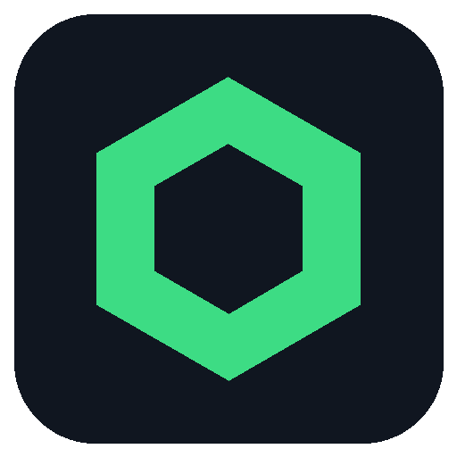

  

<h1 align="center">Hydarium</h1>

<b>Le launcher Minecraft simple, beau et communautaire.</b> 
Mods, serveurs, amis et client en jeu : tout au même endroit, en quelques clics.

  
  

  
  
  
  
  
  

  <a href="https://github.com/Gazein21/hydarium/releases/latest"><b>⬇️ Télécharger Hydarium</b></a> ·
  <a href="#-toutes-les-fonctionnalités">Fonctionnalités</a> ·
  <a href="#-questions-fréquentes">FAQ</a> ·
  <a href="https://github.com/Gazein21/hydarium/issues">Signaler un problème</a> ·
  <a href="mailto:help.point@hydarium.net">Contact</a>

---

## ✨ Pourquoi Hydarium ?

Jouer à Minecraft avec des mods, retrouver ses amis et héberger un serveur oblige souvent à jongler entre plusieurs outils, des dossiers à fouiller à la main et des réglages obscurs.

**Hydarium réunit tout dans une seule application**, claire et agréable, où chaque chose se fait en quelques clics :

| | |
|---|---|
| 🎮 **Jouer** | Instances Vanilla, Fabric, Quilt, Forge et NeoForge, connexion Microsoft, Java déjà inclus. |
| 🧩 **Modder** | Recherche Modrinth / CurseForge, dépendances automatiques, contrôle d'intégrité. |
| 🖥️ **Héberger** | Ton serveur en un clic, tes amis te rejoignent **sans ouvrir de port**. |
| 👥 **Jouer ensemble** | Amis, chat, fichiers et appels vocaux en direct, sans serveur central. |
| 🎯 **Briller en jeu** | Un client Hydarium avec widgets (FPS, CPS, touches…), zoom et luminosité. |
| 🔒 **Respecter ta vie privée** | Aucune donnée collectée ni vendue. Jamais. |

> Hydarium est un projet personnel : pas d'entreprise derrière, pas de publicité, pas de compte à créer chez nous.

---

## 🚀 Démarrage en 3 étapes

1. **Télécharge** Hydarium depuis la [page des versions](https://github.com/Gazein21/hydarium/releases/latest) :
   - **Windows** : `Hydarium-Installer.exe` (ou la version portable).
   - **Linux** : `Hydarium-Linux.AppImage`. Rends-le exécutable (`chmod +x Hydarium-Linux.AppImage`) puis lance-le, sans installation.
   - **macOS** : `Hydarium-Mac-AppleSilicon.dmg` (Mac M1 et suivants) ou `Hydarium-Mac-Intel.dmg` (Mac plus anciens). Ouvre le DMG, glisse Hydarium dans *Applications*. Hydarium n'est pas encore signé par Apple : au premier lancement, macOS le bloque. Va dans *Réglages Système › Confidentialité et sécurité*, puis clique sur **« Ouvrir quand même »** (sur macOS 14 et avant : clic droit sur l'app › *Ouvrir*). Si macOS dit que l'app est « endommagée », lance une fois dans le Terminal : `xattr -dr com.apple.quarantine /Applications/Hydarium.app`.
2. **Lance Hydarium** et connecte ton compte Microsoft. Rien d'autre à installer : Java est embarqué.
3. **Crée une instance** (ou glisse-dépose un modpack dans la fenêtre) et clique sur **Jouer**.

Les mises à jour se font ensuite **toutes seules**, en arrière-plan.

---

## 📖 Toutes les fonctionnalités

### 🎮 Jouer et organiser tes instances

Une *instance* est une installation de Minecraft indépendante (sa version, ses mods, ses mondes). Tu en as autant que tu veux, sans qu'elles se mélangent.

- **Connexion Microsoft stable** : tu n'es plus déconnecté au moindre souci réseau ou quand les serveurs de Mojang répondent mal. Le jeton est renouvelé tout seul et les erreurs sont écrites clairement.
- **Tous les types d'instances** : Vanilla, Fabric, Quilt, Forge et NeoForge. Duplique-les, règle la **mémoire** de chacune.
- **Des icônes à ton image** : un objet Minecraft dessiné sur le décor de l'instance (au choix ou automatique), l'**image officielle du modpack**, ou **ta propre image**.
- **Import sans effort** : reprends tes instances depuis **Prism, MultiMC, ATLauncher, CurseForge ou le launcher officiel**, ou **glisse-dépose** un modpack (`.mrpack`, `.zip` CurseForge ou Prism) pour créer l'instance.
- **Code de partage** : envoie une instance à un ami avec un simple code.
- **Skins** : gère tes skins, avec les skins par défaut de Minecraft que tu peux retirer et restaurer.
- **Captures d'écran** : retrouve-les directement dans le launcher.

### 🧩 Gérer tes mods sans te prendre la tête

- **Recherche et installation** depuis **Modrinth** (et CurseForge). Les **dépendances** sont installées automatiquement.
- **Contrôle d'intégrité** : chaque mod est marqué *Vérifié*, *Non vérifié* ou *Manquant*. Les **incompatibilités sont détectées avant le lancement**, avec une correction en un clic.
- **Choisis la version de chaque mod** : liste des versions compatibles, retour à une version précédente, et une version « figée » n'est pas écrasée par « Mises à jour ».
- **Filtre instantané** sur tes mods installés.
- **Des images partout** : même quand un mod n'en fournit pas, Hydarium retrouve son image (dans le jar, ou logo CurseForge) ou en génère une.
- **Glisser-déposer intelligent** : dépose un mod, un pack de ressources, un shader, un data pack ou un monde dans la fenêtre. Hydarium **reconnaît le fichier par son contenu** et le range au bon endroit.
- **Crash lisible** : quand le jeu plante, tu as un message clair avec **le mod suspect**, au lieu d'un mur de texte.

### 🖥️ Jouer sur des serveurs, ou héberger le tien

- **Rejoindre en un clic** : Hydarium prépare la bonne version du jeu et les bons mods.
- **Héberge ton serveur depuis le launcher**, avec une vue épurée. Tes amis te rejoignent par une **invitation privée en connexion directe** : **pas de port à ouvrir, pas d'adresse IP à donner**.
- **Data packs du serveur** : liste, import `.zip`, glisser-déposer, ajout depuis Modrinth, activation et désactivation.
- **Assistant de crash serveur** : si ton serveur s'arrête sans prévenir, Hydarium **trouve la cause** (port déjà pris, data pack, mod client, mémoire, Java, monde, licence…), désigne les mods suspects et propose des **réparations qui relancent le serveur**.
- **Serveur moddé, joueurs sereins** : ceux qui ont Hydarium reçoivent **la liste exacte des mods** de l'hôte, en versions exactes, et peuvent **tout installer d'un coup**. Les mods introuvables sur Modrinth sont signalés pour être installés à la main.

### 👥 Retrouver tes amis *(activable, jamais imposé)*

Tout passe **directement d'un ordinateur à l'autre**. Il n'y a pas de serveur central qui lit tes messages ou garde ta liste d'amis.

- **Amis** : code ami permanent, demandes d'amis, présence *en ligne* ou *en jeu*, mode **« apparaître hors ligne »**, blocage, et **invitation directe** à rejoindre ton serveur.
- **Chat** privé et de groupe, **partage d'instances**, **envoi de fichiers et d'images** (avec reprise automatique si la connexion coupe).
- **Appels vocaux** à deux, de PC à PC.
- **Désactivé par défaut** : une fenêtre t'explique clairement ce que ça change avant que tu l'actives.
- **Anti-spam** : une demande d'ami n'affiche pas ton pseudo tant que l'autre n'a pas décidé.

### 🎯 Le client Hydarium en jeu

Un mod maison qui ajoute tes outils préférés **directement dans Minecraft**.

- **Widgets** : touches, **CPS**, **FPS**, coordonnées, direction, armure, effets, ping, heure, mémoire, temps de session, **musique en cours**, waypoints…
- **Éditeur en jeu** : place et règle les widgets (position, taille, opacité, couleur) **sur le vrai écran**, pas dans un menu abstrait.
- **Zoom** : maintiens une touche, règle le niveau à la molette, avec une caméra cinématique.
- **Luminosité** : vois dans le noir sans toucher à tes réglages de jeu.
- **Confort de jeu** : sprint automatique, sneak permanent, marche automatique.
- **Waypoints** : pose des repères et vois leur direction et leur distance.
- **Menu par-dessus le jeu** (**Alt + H** par défaut) : change de skin, télécharge un mod ou regarde tes captures **sans quitter la partie**.
- **Un raccourci pour tout masquer** : une touche cache ou affiche tout le HUD.

> Le client en jeu est proposé pour plusieurs versions (dont 1.8.9, 1.12.2, 1.20.1 et 1.21.x). Sur les autres, le launcher affiche un HUD par-dessus le jeu.

### 🛡️ Pensé pour être à l'aise

- **Mode confidentialité** pour tes vidéos et tes streams : adresses IP, codes d'invitation et code ami sont **floutés par défaut**. Un œil pour afficher, et « Copier » marche sans rien montrer.
- **Java embarqué** : le joueur n'a rien d'autre à installer.
- **Mises à jour automatiques** en arrière-plan, sous Windows comme sous Linux. Sous macOS, le launcher te prévient et t'envoie vers la page de téléchargement.
- **Interface en français et en anglais.**
- **Un écran de bienvenue honnête** : la vie privée d'abord, puis les règles, en langage simple.

---

## 🔒 Ta vie privée, noir sur blanc

- **Aucune donnée collectée, aucune donnée vendue.**
- **Pas de serveur central** pour tes amis ou tes parties : tout est en connexion directe.
- Les fonctions sociales sont **éteintes tant que tu ne les actives pas**.
- Le code est public : tu peux **vérifier par toi-même** ce que fait Hydarium. Il n'est pas libre : merci de ne pas le redistribuer ni le revendre.

---

## ❓ Questions fréquentes

**Hydarium est-il gratuit ?**
Oui. C'est un projet personnel, sans publicité.

**Il me faut un compte Minecraft ?**
Oui, un compte Microsoft avec Minecraft Java Edition pour jouer en ligne, comme avec n'importe quel launcher.

**Je dois installer Java ?**
Non, Java est fourni avec Hydarium.

**Sur quels systèmes ça marche ?**
**Windows** (installeur ou portable), **Linux** (AppImage) et **macOS** (DMG, Intel et Apple Silicon). Windows reste la plateforme la mieux testée ; macOS est tout nouveau : pas encore signé par Apple (voir le démarrage ci-dessus) ni testé sur un vrai Mac.

**Mes amis doivent-ils ouvrir des ports pour rejoindre mon serveur ?**
Non. L'invitation privée passe en connexion directe, sans ouvrir de port ni révéler ton IP.

**Puis-je reprendre mes instances actuelles ?**
Oui : import depuis **Prism, MultiMC, ATLauncher, CurseForge et le launcher officiel**.

---

## 🗺️ Où en est le projet ?

Hydarium évolue vite et chaque version ajoute de nouvelles fonctions. Le suivi détaillé est dans [`docs/A-FAIRE.md`](docs/A-FAIRE.md) et [`docs/FICHE-DE-REPRISE.md`](docs/FICHE-DE-REPRISE.md).

**Prochaines pistes** : une interface plus « Minecraft » (angles carrés, boutons façon jeu) et, plus tard, une version « ultra optimisée » proposée à la création d'une instance.

## 💬 Aide et contact

Un bug, une idée, une suggestion ? Ouvre une [issue](https://github.com/Gazein21/hydarium/issues) ou écris-nous à **[help.point@hydarium.net](mailto:help.point@hydarium.net)**. Chaque retour compte.

---

## 🛠️ Pour les curieux et les développeurs

Hydarium est une application [Electron](https://www.electronjs.org/) : interface web (`src/renderer/`) et processus principal Node (`src/main/`), plus un mod client écrit en Java (`client-mod/`).

- Lancer en développement : `npm install` puis `npm start` (Node.js 20+ et Java 21), ou `lancer-dev.bat` sous Windows.
- Lancer les tests : `npm test`.
- Fabriquer l'installeur : `build-windows.bat` (ou `npm run dist:win`) ; Linux : `npm run dist:linux` ; macOS : `npm run dist:mac` (à lancer sur un Mac).
- Publier une version : `npm run release -- X.Y.Z`, voir [`docs/PUBLIER-SUR-GITHUB.md`](docs/PUBLIER-SUR-GITHUB.md).
- Architecture, pièges et prochaines étapes : [`docs/FICHE-DE-REPRISE.md`](docs/FICHE-DE-REPRISE.md).
- Le mod client : [`docs/HYDARIUM-CLIENT.md`](docs/HYDARIUM-CLIENT.md).

---

Hydarium n'est ni affilié, ni approuvé par Mojang ou Microsoft. Minecraft est une marque de Mojang Studios.

